# Tasklane: Where New Users Drop Off, Who Churns, and Whether to Ship the New Onboarding

**Product analytics case study for a B2B project-management SaaS.** Funnel, retention, churn, segmentation and a randomised A/B test, ending in a ship / don't ship recommendation.

> **Data note:** Tasklane is a fictional company and every number here comes from a simulated dataset built for this case study (126K users, 4.3M events). The experiment's treatment assignment is simulated too. The analysis, definitions and decision logic are the real thing.

| Deliverable | Where |
|---|---|
| **Decision memo** (start here) | [docs/experiment_decision_memo.md](docs/experiment_decision_memo.md), also as a [PDF](docs/experiment_decision_memo.pdf) |
| Statistical test notebook | [notebooks/ab_test_analysis.ipynb](notebooks/ab_test_analysis.ipynb) |
| Event-level SQL analysis | [sql/](sql/) |
| Product dashboard (Power BI) | [powerbi/Tasklane.pbip](powerbi/Tasklane.pbip), [measures](powerbi/measures.dax) |
| Everything else (data generator, charts, outputs) | [Repo guide](#8-repo-guide-and-how-to-reproduce) |

---

## 1. Background and Overview

**Tasklane** sells project-management software to small and mid-sized teams. Anyone can start a free 14-day trial; revenue comes from three paid plans (Starter $29, Team $79, Business $199 per month, with an annual option at 15% off). In 2025 Tasklane signed up about 125,000 people, and about 11% of them became paying customers.

I am the product analyst supporting Growth and Product. Leadership asked four questions:

1. **Where do new users get stuck** between signup and paying?
2. **Who sticks around and who churns,** by acquisition channel, plan and engagement?
3. **Which behaviours predict retention,** so onboarding can push people toward them?
4. **Should we ship the new guided onboarding checklist** that Product tested in Q4?

Business goals: raise the share of signups who reach value (activation), turn more of them into paying customers, and keep them.

---

## 2. Data Structure Overview

Five tables, one row per entity, joined on `user_id`.

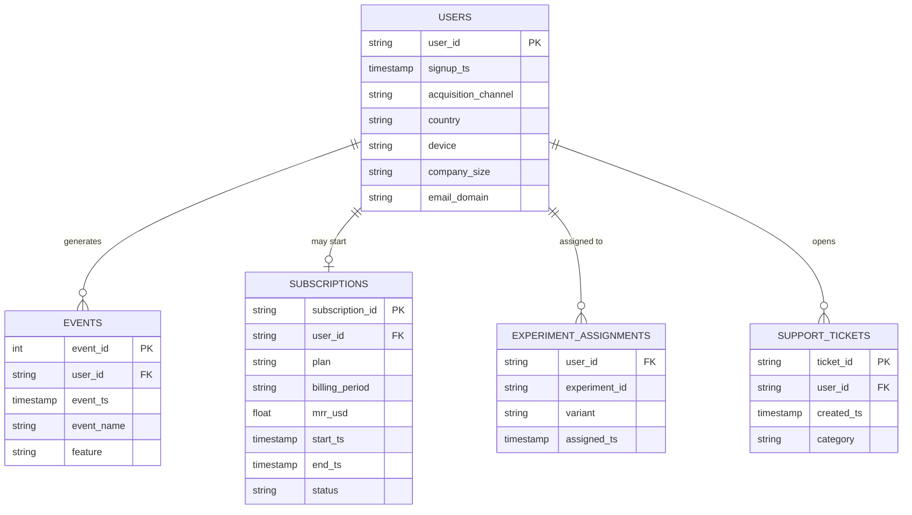

| Table | Grain | Rows | What it holds |
|---|---|---|---|
| `users` | One per signup | 125,852 | Channel, device, company size, signup time |
| `events` | One per product action | 4.3M | Signup, verification, project created, teammate invited, tasks, comments, five feature events, subscription start |
| `subscriptions` | One per paying customer | 14,239 | Plan, billing period, MRR, start and end date |
| `experiment_assignments` | One per user per test | 18,053 | Control or treatment, assigned at signup |
| `support_tickets` | One per ticket | 10,711 | Ticket category and time, used as a guardrail |

**Key definitions**

| Term | Definition |
|---|---|
| **Activated** | Created a first project **and** invited a teammate within 7 days of signup |
| **Active** | At least one in-product action in the period (verification and billing events do not count) |
| **Paid conversion** | Started a paid subscription (any time, or within 30 days for the experiment) |
| **Monthly churn** | Customers who ended in a month divided by customers active at its start |
| **Engagement tier** | In-product actions in the first 7 days: low 0 to 2, medium 3 to 9, high 10 or more |

Raw data is cleaned in one place ([sql/00_clean.sql](sql/00_clean.sql)); every analysis reads from the cleaned layer. Data issues found and fixed are listed in [Caveats](#6-caveats-and-assumptions).

---

## 3. Executive Summary

**Activation is Tasklane's biggest leak.** Only 33% of signups activate, yet activated users are about 11 times more likely to pay (29.4% vs 2.7%) and stay far longer (46% vs 7% still active after 12 weeks). The break happens at one step: only half of the people who create a project invite a teammate in their first week. **A randomised test of a guided onboarding checklist lifted 7-day activation by 3.0 points (32.6% to 35.6%, 95% interval +1.6 to +4.4), worth roughly $13.6K of new monthly recurring revenue at current volume.** I recommend shipping it through a staged rollout with a 5% long-term holdout, because the revenue effect is borderline and the support-ticket guardrail was too thinly powered to settle. Beyond onboarding, the next-best levers are a non-teammate activation path for solo accounts, shifting acquisition toward referral, and retention work on monthly Team and Starter plans.

---

## 4. Insights Deep Dive

### 4.1 Activation, not signup, is the bottleneck

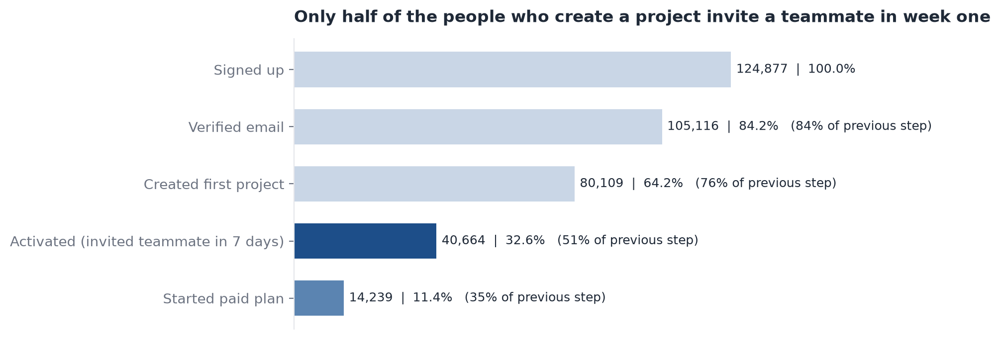

| Funnel step | Users | Share of signups | Share of previous step |
|---|---|---|---|
| Signed up | 124,877 | 100% | |
| Verified email | 105,116 | 84.2% | 84% |
| Created first project | 80,109 | 64.2% | 76% |
| **Activated (invited a teammate in 7 days)** | **40,664** | **32.6%** | **51%** |
| Started paid plan | 14,239 | 11.4% | 35% |

- **Why it matters:** Activated users pay at **29.4%** versus **2.7%** for everyone else, so each extra activated user is worth about $22 of new MRR on average (27 points x $83).
- **Timing:** The median new user takes 20 hours to create a project, then another 36 hours to invite a teammate (if they do). The median time from signup to paying is 14 days, which is exactly the trial length.

### 4.2 The invite step breaks for solo accounts and mobile users

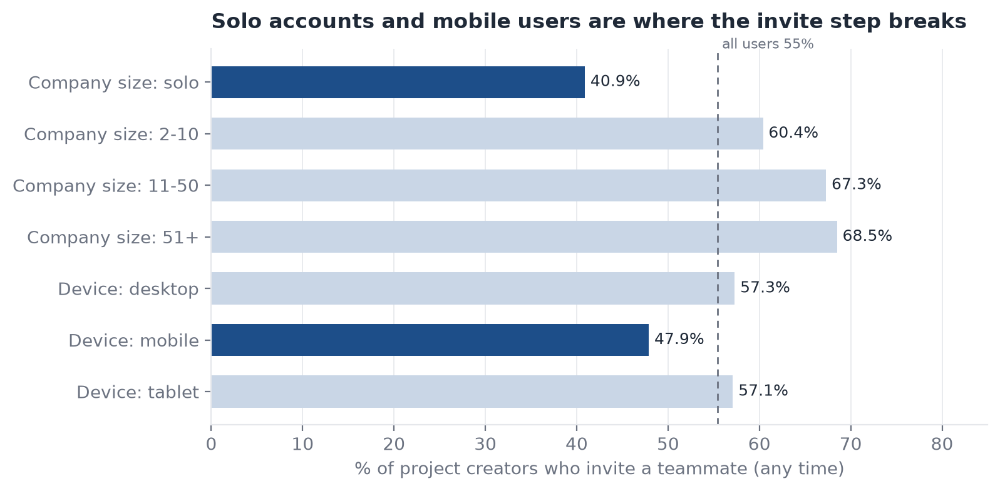

- **Solo accounts:** 41% invite a teammate after creating a project, against 60% to 69% for teams. Solo users are 35% of signups and activate at **24%**, compared with 36% to 40% for teams. Our activation definition requires a teammate, so for them it may be the wrong goal.
- **Mobile:** 48% invite versus 57% on desktop, and mobile activation is **28%** against 34% on desktop.

### 4.3 Retention: stable cohorts, but only activated users stay

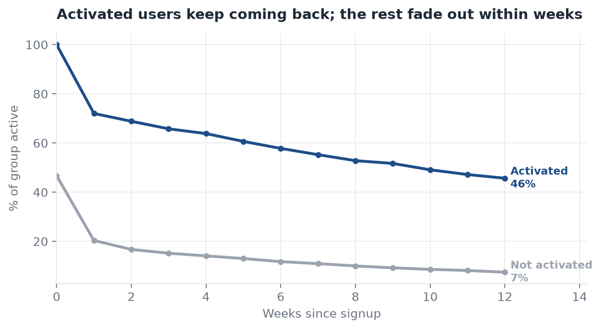

- Across all signups, **37% are active in week 1, 30% in week 4 and 24% in week 8.**
- **Activated users retain at 46% at week 12; non-activated at 7%.** Week 0 is high for activated users partly by definition.
- **Cohort quality is steady month to month** ([monthly cohorts](docs/images/cohort_monthly.png), [weekly cohorts](docs/images/cohort_weekly.png)). The one visible dip is March, when a three-week paid-social push lifted that channel to 31% of signups and week-4 retention fell to 28.2% against about 30% in other months.
- **39% of signups (43,593 of 110,416 from Jan to Nov) do almost nothing in week 1, and 98% of them are not active by week 4.** The 5,829 high-engagement users (5%) are still active at 77% in week 4.

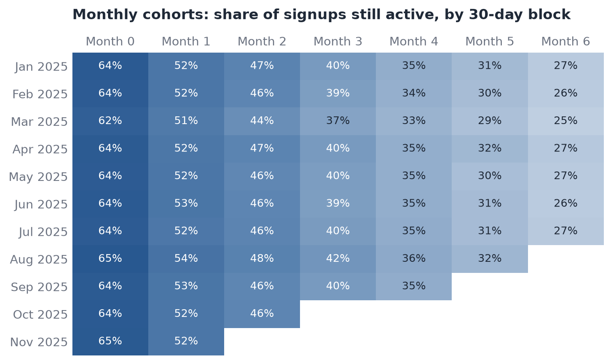

### 4.4 Channels differ in value, but not in how long customers stay

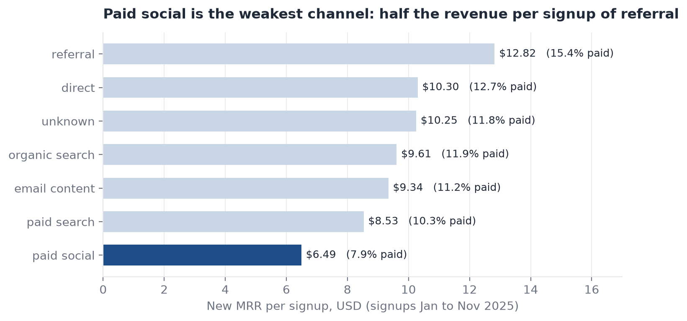

| Channel | Signups | Activated | Paid | New MRR per signup |
|---|---|---|---|---|
| Referral | 12,045 | 38.7% | 15.5% | **$12.82** |
| Direct | 18,064 | 34.6% | 12.7% | $10.30 |
| Organic search | 33,696 | 33.9% | 11.9% | $9.61 |
| Email / content | 14,450 | 32.0% | 11.4% | $9.34 |
| Paid search | 23,919 | 30.7% | 10.4% | $8.53 |
| **Paid social** | 19,556 | **27.0%** | **7.9%** | **$6.49** |

- **Referral signups are worth about twice paid social signups.** Moving 1,000 signups from paid social to referral would add about **$6.3K of new MRR**. This dataset has no spend, so the cost side of the trade is still open.
- Once someone is paying, channel barely matters: 6-month retention of monthly customers is 80% to 84% across every channel. What matters is **activation** (85% for customers activated in week 1 versus 68% for the rest) and **plan**.

### 4.5 Churn is concentrated in monthly plans, and revenue churn is rising with scale

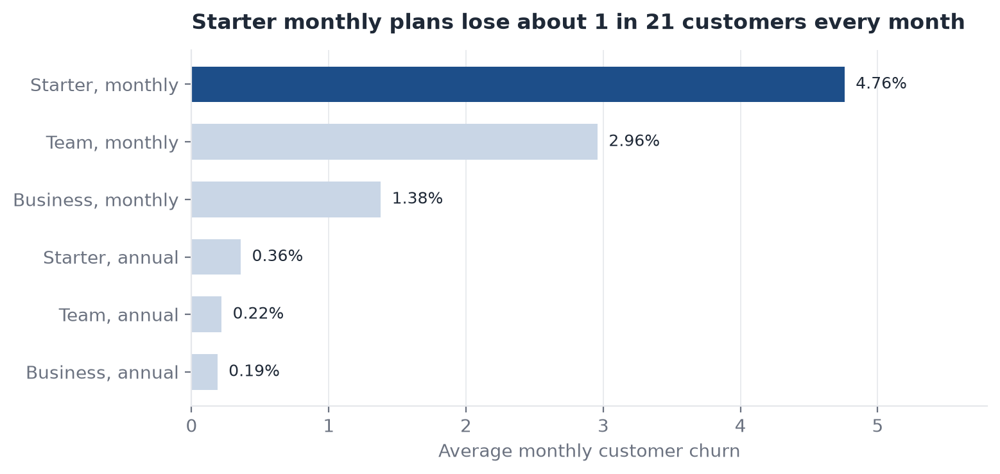

| Plan, billing | Customers | Monthly churn | Approx. MRR lost |
|---|---|---|---|
| Starter, monthly | 4,240 | **4.76%** | $31K |
| Team, monthly | 5,041 | 2.96% | **$68K** |
| Business, monthly | 1,852 | 1.38% | $30K |
| Annual plans (all three) | 3,106 | 0.19% to 0.36% | $4K |

- **Starter monthly has the highest churn rate (about 1 in 21 customers a month), but Team monthly loses the most revenue** because it is larger and pays more. A rate-only view would aim at the wrong plan.
- Annual plans show 0.19% to 0.36% monthly churn because customers can only leave at renewal, and annual buyers are a self-selected group. This is not proof that an annual offer would reduce churn.

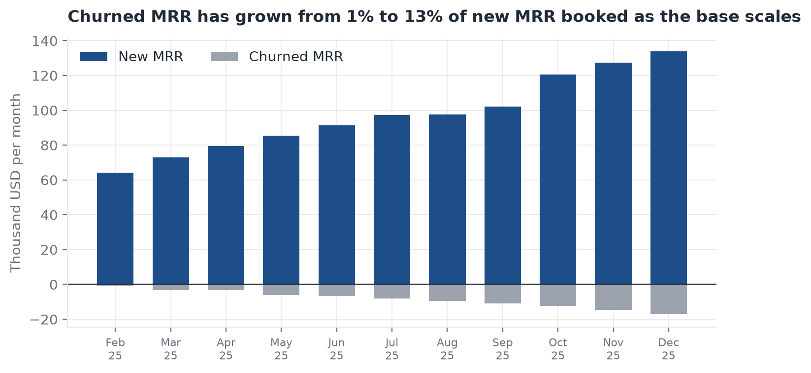

- New MRR grew from $64K to $134K a month through 2025. Churned MRR grew faster, from **1% to 13% of new MRR booked**, as the customer base reached about 10,800.

### 4.6 Integrations and automations look sticky, but half of that is selection

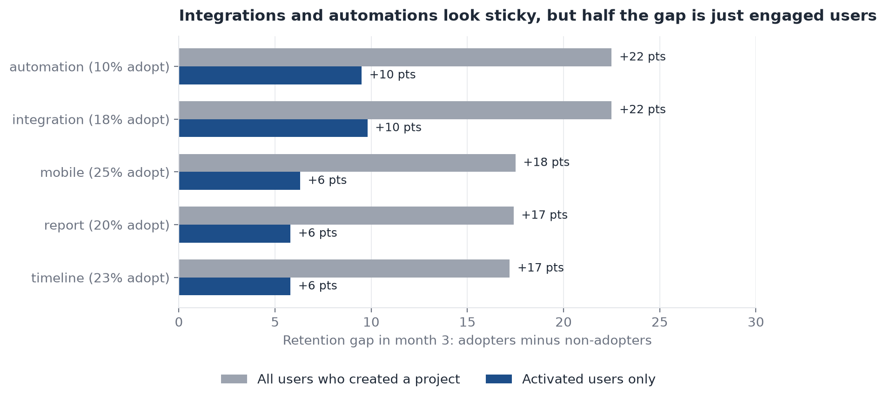

- Users who adopt **automations** (10% of project creators) or **integrations** (18%) in their first 30 days are about **22 points** more likely to be active in month 3.
- Compare only **activated** users and the gap falls to about **10 points**. The rest is engaged users doing more of everything. A 10-point gap is still worth testing, but this is correlation, not proof that a feature creates retention.

### 4.7 A/B test: the guided checklist lifts activation

Control is the current onboarding. Treatment is a guided setup checklist that prompts users to create a project and invite a teammate. Users were randomised 50/50 at signup between 13 Oct and 23 Nov 2025. Design: sample size planned up front (5,668 per arm for 80% power to detect +2.5 points), fixed horizon, two guardrails, and Holm correction across secondary metrics.

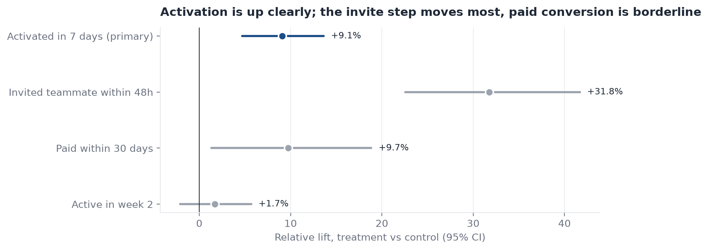

| Metric | Control | Treatment | Difference | 95% interval | p-value |
|---|---|---|---|---|---|
| **7-day activation (primary)** | 32.64% | 35.60% | **+2.96 pts** | +1.57 to +4.35 | < 0.001 |
| Invited a teammate within 48h | 12.42% | 16.37% | +3.95 pts | +2.92 to +4.98 | < 0.001 |
| Paid within 30 days | 11.44% | 12.55% | +1.11 pts | +0.16 to +2.07 | 0.045 (adjusted) |
| Active in week 2 (guardrail) | 36.90% | 37.53% | +0.64 pts | -0.79 to +2.06 | 0.38 |
| Support tickets per user (guardrail) | 0.0386 | 0.0379 | ratio 0.98 | 0.84 to 1.14 | inconclusive |

- **Statistical significance:** the primary result is very unlikely to be chance (p = 0.00003). A bootstrap and a covariate-adjusted model give the same answer (+2.93 points).
- **Practical significance:** we set +1.0 point as the minimum worth shipping (worth about $3.0K new MRR a month). The observed lift is three times that, and the bottom of the interval clears it.
- **Revenue impact:** +397 activated users and about **+$13.6K new MRR per month** at 13,400 signups a month. The range is wide ($0.1K to $27.1K) because the test had about 53% power to detect a +1 point paid lift.
- **Trust checks passed:** the split was 8,797 vs 8,973 (p = 0.19), groups were balanced, and the estimate settled well before the test ended ([cumulative chart](docs/images/exp_cumulative.png)).
- **Who benefits is unclear.** Lifts by segment range from -1.4 to +5.3 points with wide intervals, and no interaction test is significant, so these are hypotheses for the next test ([segment chart](docs/images/exp_segments.png)).

**Decision: ship, via staged rollout.** All criteria were met except the ticket guardrail, which is inconclusive: the point estimate is fine (0.98) but tickets are so rare that the interval (0.84 to 1.14) cannot rule out a 10% rise. Full reasoning, rollout triggers and open risks are in the [decision memo](docs/experiment_decision_memo.md).

---

## 5. Recommendations

| # | Action | Evidence | Expected impact | How to measure |
|---|---|---|---|---|
| 1 | **Ship the guided checklist in stages** (50% for 14 days, then 95% with a 5% holdout for 90 days) | +2.96 pts activation, interval above the 1.0 pt bar | About +400 activated users and +$13.6K new MRR a month | Holdout read on week-8 retention, 90-day churn and tickets |
| 2 | **Test a non-teammate activation path for solo accounts** (for example, create three tasks) | Solo users are 35% of signups, invite at 41%, activate at 24% | Each +4 pts of solo activation is about +190 activated users and +$4K MRR a month | A/B test on solo signups, with a revised activation definition |
| 3 | **Shift acquisition toward referral and review paid social economics** | Referral $12.82 vs paid social $6.49 new MRR per signup; paid social activates at 27% | About $6.3K more new MRR per 1,000 signups moved (before spend) | Join channel spend to cost per paying customer |
| 4 | **Target retention at monthly Team plans first, then Starter** | Team monthly loses about $68K of MRR; Starter has the highest rate (4.76%) | Each 0.5 pt cut in Team monthly churn would have saved about $11K of MRR over the period | Test an annual-plan offer and a check-in for non-activated customers |
| 5 | **Rescue the 39% of signups who do almost nothing in week 1** | 43,593 users (Jan to Nov), 98% inactive by week 4 | Even a 2 pt recovery is about 870 users over that period | Test day-1 and day-3 prompts; track week-4 retention |
| 6 | **Test prompting integrations and automations in week 2** | Adopters stay about 10 pts more among activated users | Uncertain until tested | A/B test the prompt; read month-3 retention |
| 7 | **Fix mobile invite flow** | Mobile invite 48% vs 57% desktop; checklist helped little on mobile | About +$1.7K MRR a month if half the gap closes | A/B test a mobile invite step |
| 8 | **Size guardrails properly in the next test** | Tickets guardrail was inconclusive | Faster, cleaner decisions | Pre-registered power calculation for each guardrail |

---

## 6. Caveats and Assumptions

**Data quality issues found and handled** (see [sql/01_data_quality.sql](sql/01_data_quality.sql)):

| Issue | Rows affected | Treatment |
|---|---|---|
| Internal test accounts (tasklane.com) | 975 users (0.8%) | Excluded everywhere |
| Missing acquisition channel | 3,182 users (2.5%) | Kept as "unknown"; behaves like average signups |
| Missing country | 1,260 users (1.0%) | Kept as "unknown"; country is not used in results |
| Exact duplicate events | 25,635 (0.6%) | Removed, keeping the first |
| Events stamped before signup (clock skew) | 557 | Timestamp moved to signup time |
| Users shown both experiment arms | 72 | Excluded from the test |

**Limitations**

- **Simulated data.** Real data would add bots, one person on several devices, and tracking gaps. Effect sizes here are by design and should not be read as industry benchmarks.
- **The experiment only observes 30 days of paid follow-up** and 2 weeks of usage. Long-run retention and churn effects of the checklist are not known; that is what the holdout is for.
- **The ticket guardrail was under-sized.** I flagged it as inconclusive rather than loosening the limit after seeing the result.
- **Segment, feature and channel comparisons are associations.** Subgroup lifts come from underpowered cuts; feature adopters are more engaged to begin with; annual customers differ from monthly ones.
- **No cost data.** Channel recommendations cover revenue per signup, not return on spend. The $3.0K per month "practical bar" for the checklist is an assumption that Product should confirm against real build and maintenance cost.
- **Revenue figures are new MRR booked before churn,** not lifetime value. Billing months are approximated as 30.44 days.
- **Activation is defined by a teammate invite,** which structurally disadvantages solo accounts (recommendation 2).

---

## 7. Dashboard

The Power BI project ([powerbi/Tasklane.pbip](powerbi/Tasklane.pbip)) has four pages: executive summary and funnel, cohort retention, segments and churn, and the experiment readout. Slicers for channel, device and company size filter the summary page, and the experiment page has the same slicers for exploratory segment cuts. It follows the same visual rules as the charts here: one accent colour, one axis per chart, titles that state the finding.

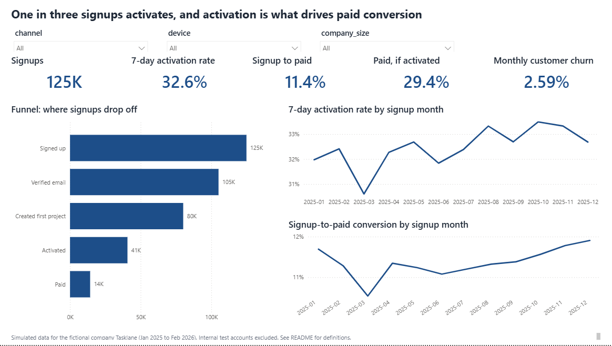

<details>
<summary>See the other three pages</summary>

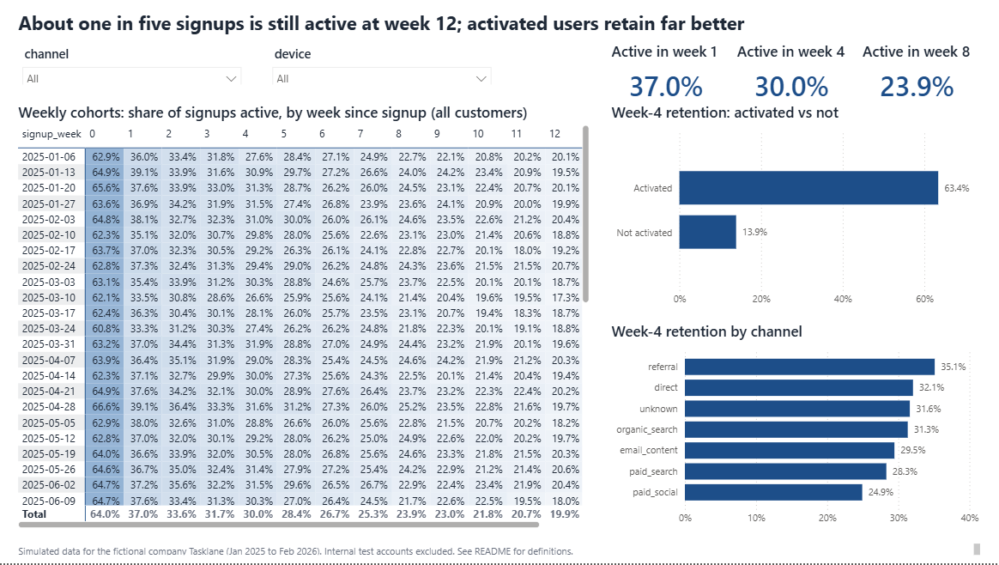
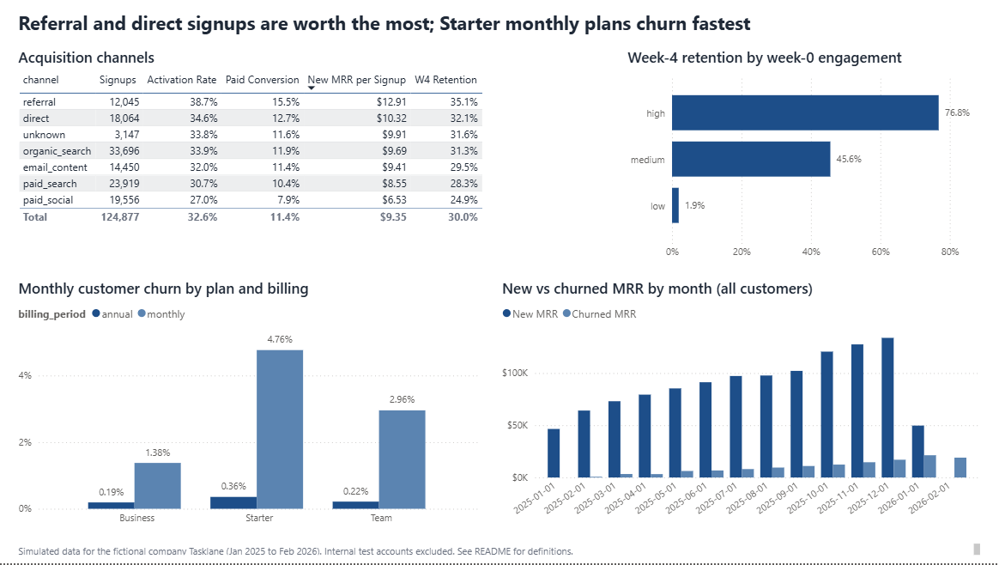
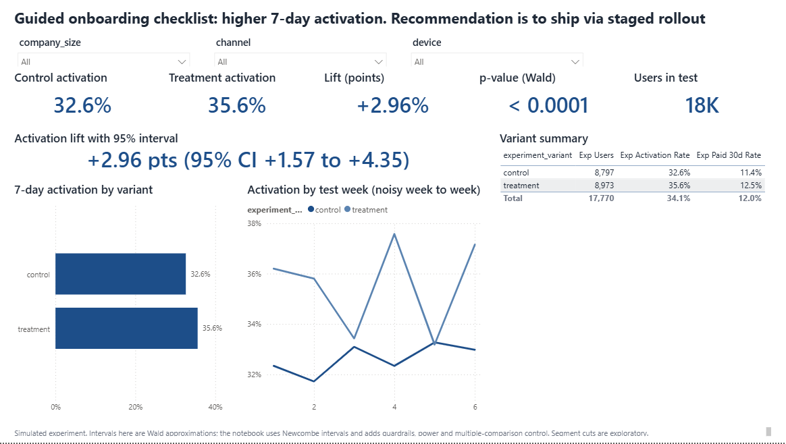

</details>

To open it: install the data with the steps below, double-click `Tasklane.pbip` (Power BI Desktop, April 2025 or later), click **Refresh** on the banners, and edit the `DataFolder` parameter if the repo is in a different folder. Measures are in [powerbi/measures.dax](powerbi/measures.dax). Sanity checks after refresh: 124,877 signups, 32.6% activation, 11.4% signup-to-paid, and 4.76% monthly churn for Starter monthly plans. The dashboard covers all signups through December, so channel revenue per signup differs slightly from the January to November figures in section 4.4 (for example referral $12.91 vs $12.82).

---

## 8. Repo Guide and How to Reproduce

```
sql/            00_clean.sql plus seven analysis files (data quality, funnel, retention, churn,
                feature adoption, segmentation, experiment). DuckDB dialect.
python/         generate_data.py (seeded simulator), run_pipeline.py (SQL runner),
                make_charts.py, build_notebook.py, build_memo_pdf.py, export_powerbi_data.py
notebooks/      ab_test_analysis.ipynb (executed, with outputs)
outputs/        CSV result of every named SQL query, plus exp_results.json
powerbi/        Tasklane.pbip, model data, theme, measures.dax, build_pbip.py
docs/           experiment_decision_memo (.md and .pdf), dashboard screenshots, chart images
```

```bash
python -m venv .venv && .venv/Scripts/pip install -r requirements.txt   # Windows
python python/generate_data.py          # simulate the dataset (seeded, about 1 minute)
python python/run_pipeline.py           # load into DuckDB, run all SQL, write outputs/
python python/build_notebook.py         # run the statistics notebook, write outputs/exp_results.json
python python/make_charts.py            # README charts
python python/build_memo_pdf.py         # memo PDF (needs Playwright's Chromium: playwright install chromium)
python python/export_powerbi_data.py    # Power BI tables
python powerbi/build_pbip.py            # regenerate the Power BI project
```

**Skills shown:** window functions and cohort SQL (DuckDB), funnel and retention design, churn and MRR bridges, experiment design (power, SRM, guardrails, multiple-comparison control), Python statistics (statsmodels, scipy), Power BI data modelling and DAX, and stakeholder writing.
